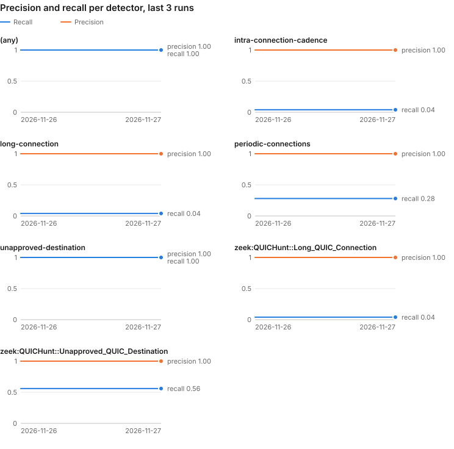

# Detection lab results

Nightly results of the Docker detection lab: every reference detection scored against simulator ground truth. This branch is written by the `Lab end-to-end` workflow; don't edit it by hand.

## Latest run

2026-11-26 05:40 UTC, commit [`897ef49`](https://github.com/1337-llama/QUIC-Research-and-Defense/commit/897ef49135cae40847030c1e23a6f038e449d632): gates passed. 81 sessions (25 malicious, 56 benign). [Workflow run](https://github.com/1337-llama/QUIC-Research-and-Defense/actions/runs/45762225066).

| Detector | Precision | Recall | F1 | Recall change |
|---|---:|---:|---:|---:|
| `(any)` | 1.000 | 1.000 | 1.000 | – |
| `intra-connection-cadence` | 1.000 | 0.040 | 0.077 | – |
| `long-connection` | 1.000 | 0.040 | 0.077 | – |
| `periodic-connections` | 1.000 | 0.280 | 0.438 | – |
| `unapproved-destination` | 1.000 | 1.000 | 1.000 | – |
| `zeek:QUICHunt::Long_QUIC_Connection` | 1.000 | 0.040 | 0.077 | – |
| `zeek:QUICHunt::Unapproved_QUIC_Destination` | 1.000 | 0.560 | 0.718 | – |

## Over time

## Recent runs

The table view of the chart's combined score, newest first.

| Time (UTC) | Commit | Gates | Sessions | `(any)` precision | `(any)` recall | Run |
|---|---|---|---:|---:|---:|---|
| 2026-11-26 05:40 | [`897ef49`](https://github.com/1337-llama/QUIC-Research-and-Defense/commit/897ef49135cae40847030c1e23a6f038e449d632) | passed | 81 | 1.000 | 1.000 | [log](https://github.com/1337-llama/QUIC-Research-and-Defense/actions/runs/45762225066) |
