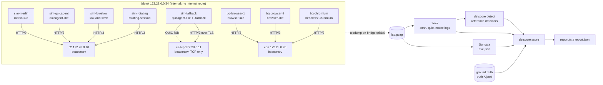

# 7. The Detection Lab

The detection lab runs the whole loop in Docker. It generates labeled QUIC traffic, captures it, runs it through Zeek and Suricata, and **scores every detection against ground truth**. The result is a precision and recall table rather than an "it fired once" anecdote.

## 7.1 Architecture



The scenario mirrors a common enterprise setup. Malicious profiles beacon to a "C2" server. Benign traffic goes to a "CDN", which is the destination your policy approves.

| Container | Role | What it tests |
|---|---|---|
| `sim-merlin` | One persistent connection with keep-alives | Long-connection and in-connection cadence detection |
| `sim-quicagent` | A new connection per beacon | Periodicity between connections |
| `sim-fallback` | QUIC first; HTTP/2 over TLS/TCP when QUIC fails | Whether detections follow a beacon off QUIC (see 7.5) |
| `sim-lowslow` | A few widely jittered beacons (90s, 50% jitter) | A hard case: too few connections for periodicity in a short run |
| `sim-rotating` | Periodic beacons on connections replaced every 2 minutes | A hard case: no connection lives long enough for long-connection |
| `bg-browser-1`, `bg-browser-2` | Synthetic bursty browsing | Benign background from the simulator |
| `bg-chromium` | Real headless Chromium loading the CDN page over QUIC | Benign background with a real browser's handshake and JA4 |

`c2-tcp` only listens on TCP. To the fallback simulator that is indistinguishable from a network that blocks UDP/443: every QUIC attempt times out (after `-quic-timeout 3s`) and the session completes over HTTPS instead. Its ground truth records `"transport":"tcp"`, and the failed QUIC attempts show up as unmatched one-sided UDP flows.

Chromium writes no ground truth of its own. After Zeek runs, `detscore label` turns every connection from its address in `conn.log` into a benign session record, so the browser's traffic is scored like everything else.

## 7.2 Running it

You need a **Linux** Docker host, because the capture container sniffs the lab bridge from the host network namespace. The run takes about 8 minutes. `LAB_DURATION` accepts the forms `90s`, `6m` and `1h`.

```sh
make lab-tidy      # first time only: resolve lab/go.sum
make lab-run       # or: lab/harness/run.sh
```

To keep the containers running for inspection, or to change the run length:

```sh
LAB_KEEP=1 LAB_DURATION=15m lab/harness/run.sh
```

Pass `detscore score` gates to make the run fail (exit 3) when detections regress:

```sh
lab/harness/run.sh -require '(any):recall>=0.95' -require 'unapproved-destination:precision>=0.95'
```

## 7.3 Outputs

Everything lands in `lab/harness/out/`:

| File | Contents |
|---|---|
| `lab.pcap` | The capture: all UDP plus TCP/443 |
| `keys-*.log` | TLS secrets per simulator. In Wireshark, set *Preferences → Protocols → TLS → (Pre)-Master-Secret log filename* to see inside the HTTP/3 traffic |
| `truth-*.jsonl` | Ground truth from each simulator, plus `truth-chromium.jsonl` labeled from `conn.log` |
| `zeek/` | Zeek logs in JSON (`conn.log`, `quic.log`, `notice.log`, …) |
| `suricata/` | `eve.json` and Suricata's own logs |
| `alerts.jsonl` | Output of the reference detectors |
| `cadence.jsonl` | Output of the packet-timing cadence detector |
| `ja4.txt` | JA4 fingerprints seen by Suricata, grouped by fingerprint, with the profiles that produced them |
| `report.txt`, `report.json` | The scored results |
| `simulators.log`, `servers.log` | Container logs |

## 7.4 Reading the report

```text
sessions: 19 (malicious 7, benign 12)

                                  detector|  alerts|  TP|  FP|  FN|  TN|  unmatched|  precision|  recall|     F1|
                                     (any)|      17|   7|   1|   0|  11|          0|      0.875|   1.000|  0.933|
                           long-connection|       1|   1|   0|   6|  12|          0|      1.000|   0.143|  0.250|
                               missing-sni|       1|   0|   1|   7|  11|          0|      0.000|   0.000|  0.000|
                      periodic-connections|       6|   6|   0|   1|  12|          0|      1.000|   0.857|  0.923|
  suricata:QUIC client with suspicious JA4|       1|   1|   0|   6|  12|          0|      1.000|   0.143|  0.250|
                    unapproved-destination|       7|   7|   0|   0|  12|          0|      1.000|   1.000|  1.000|
       zeek:QUICHunt::Long_QUIC_Connection|       1|   1|   0|   6|  12|          0|      1.000|   0.143|  0.250|
```

This is the scorer's golden test output for its fixture scenario. Real lab runs vary slightly with timing.

- Scoring is **per session**, meaning per QUIC connection, because that is what sensors log. A session counts as detected when at least one of the detector's alerts has the same endpoints (in either direction) and a timestamp within the session's lifetime, plus a tolerance (`-tolerance`, default 5s).
- **TP / FN** count malicious sessions caught or missed. **FP / TN** count benign sessions flagged or left alone.
- **unmatched** counts alerts that matched no simulator session, such as background noise or traffic outside the run.
- **(any)** combines every detector, the way a SOC sees the union of its alerts.
- Detector names are prefixed by source: `zeek:<note>` for Zeek notices, `suricata:<signature>` for Suricata alerts, and bare names for the reference detectors.

Each detector's numbers show what it is good at:

- **long-connection** catches the persistent Merlin-like session and nothing else. That's high precision and low recall on its own.
- **periodic-connections** catches the per-beacon QUICAgent-like pattern, because jittered beacons have a far lower gap variance than human browsing.
- **unapproved-destination** catches everything here, because the scenario has a clean allowlist. Real environments need a well-maintained one for this to work.
- **missing-sni** shows a false positive. A benign client without SNI is flagged, which is why it belongs in a scoring model rather than paging someone.

## 7.5 Reference detectors

`detscore detect` implements the detection guide's Tier 1 and Tier 3 ideas ([chapter 4](04-detection-guide.md)) over Zeek logs:

| Detector | Flags | Key flag |
|---|---|---|
| `long-connection` | QUIC connections lasting at least the threshold | `-long-connection 1h` |
| `unapproved-destination` | QUIC to anything outside approved networks | `-approved 203.0.113.0/24,...` |
| `nonstandard-port` | QUIC on a port other than the expected ones | `-ports 443` |
| `periodic-connections` | Client/server pairs whose connection start gaps have a low coefficient of variation | `-periodic-min 5 -periodic-max-cv 0.35` |
| `missing-sni` | QUIC handshakes with no server name | `-missing-sni` |
| `intra-connection-cadence` | One connection whose client wakes up on a regular schedule, measured from packet timing (`detscore cadence -pcap`) | `-burst-gap 1s -min-bursts 8 -max-cv 0.35` |

With `-include-tls`, which the lab passes, the long-connection, unapproved-destination, nonstandard-port and periodic-connections detectors also apply to TLS over TCP (Zeek service `ssl`). Without it, the fallback simulator's sessions are invisible to them: blocking QUIC moved the beacon, and a QUIC-only detection stack lost it. That is the point of the scenario. Run the lab once without the flag to see the recall drop.

The cadence detector closes a gap the flow-based detectors leave open. A persistent C2 connection (the Merlin-like profile) is a single conn.log line, so periodicity *between* connections can't see it. Inside the connection, though, the client sends a burst of packets for each beacon and keep-alive. The detector splits client packets into bursts separated by at least `-burst-gap` of silence, and flags connections whose burst start times are evenly spaced.

The Zeek script in [`detections/zeek/quic-hunting.zeek`](../detections/zeek/quic-hunting.zeek) implements the long-connection and unapproved-destination checks as Zeek notices, so you can deploy the same logic on a live sensor. The Suricata rules are in [`detections/suricata/`](../detections/suricata/).

## 7.6 JA4 fingerprints

The lab enables JA4 in Suricata, and `detscore ja4` groups the fingerprints it sees by client, naming the profiles that produced each one:

```text
PROTO  JA4                                   EVENTS  PROFILES                                              SNI
quic   q13d0311h3_55b375c5d22e_653d80c3fe9d  12      chromium (benign)                                     cdn
quic   q13d0313h3_55b375c5d22e_f902b76752af  65      browser-like (benign), low-and-slow (malicious),      c2,c2-tcp,cdn
                                                     merlin-like (malicious), quicagent-like (malicious),
                                                     rotating-session (malicious)
tls    t13d1312h2_f57a46bbacb6_ab7e3b40a677  11      quicagent-like (malicious)                            c2-tcp
```

This is from a CI run of the lab (Chromium 159, quic-go 0.65, Go 1.26), trimmed to fit. Your values depend on those versions.

The lesson is in the grouping. Every simulator profile, malicious or benign, shares one fingerprint, because JA4 identifies the **TLS/QUIC library and its configuration**, not intent. The real browser has a different one. The fallback beacon shows up a third time, as a Go `crypto/tls` fingerprint on TCP. JA4 is therefore excellent for spotting *non-browser software* speaking QUIC, which is the Tier 2 detection in [chapter 4](04-detection-guide.md#tier-2-handshake-from-the-decryptable-client-initial), and useless for telling good Go programs from bad ones. Don't write production rules from lab fingerprints.

## 7.7 Scoring your own detections

`detscore score` accepts alerts from Zeek (`-notice`), Suricata (`-eve`) and itself (`-alerts`). To score a new detection:

1. Run the lab with `LAB_KEEP=1`, or reuse a previous `out/` directory.
2. Run your detection over `out/lab.pcap` (Zeek script or Suricata rule), or over the Zeek logs.
3. Score it:

   ```sh
   go run ./cmd/detscore score \
     $(for f in lab/harness/out/truth-*.jsonl; do printf -- '-truth %s ' "$f"; done) \
     -notice my-notice.log -eve my-eve.json
   ```

4. Add a `-require` gate to [`lab-e2e.yml`](../.github/workflows/lab-e2e.yml) once you're happy with it, so a regression fails CI.

## 7.8 Limits

- The lab measures detections against **simulated** behavior. The profiles follow published reporting, but real implants vary. Treat lab scores as a regression suite, not proof of coverage.
- Handshake fingerprints (JA4) come from the quic-go version pinned in `lab/go.mod`. Don't write production rules from them.
- Most background traffic is synthetic. The Chromium container adds a real browser, but one browser loading one page is still far quieter and more uniform than an office, so expect lower precision in production than in the lab.
- The hard-case profiles are deliberately at the edge of what a 6-minute run can catch. Their per-detector recall is expected to be low; the gates only require that *some* detection catches them.

---

**Previous:** [6. The beacon simulator](06-beacon-simulator.md) · **Next:** [8. Emulating Merlin in a lab](08-merlin-lab-guide.md)
