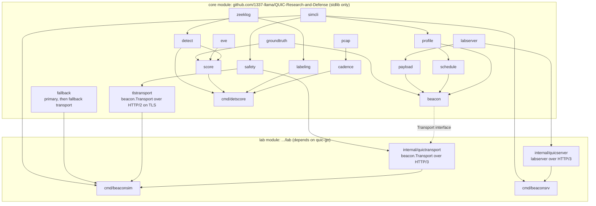

# 9. Architecture and Testing

This chapter is for engineers who want to review, extend or trust the tooling.

## 9.1 Module layout

The key design decision is the split between two modules:

- **The core module has no dependencies.** Profiles, scheduling, safety policy, payloads, ground truth, the beacon runner, the lab's HTTP handler, CLI parsing, log parsers, detectors and the scorer use only the standard library. CI enforces this. The core is easy to audit, quick to build, and fully testable without a network.
- **The HTTPS fallback lives in the core.** HTTP/2 over TLS needs only the standard library, so `tlstransport` and the `fallback` combinator are core packages, tested against the real lab handler over loopback TLS. Only the QUIC side needs the lab module.
- **The lab module is a thin adapter.** It implements the runner's `Transport`/`Session` interfaces with quic-go and serves the core's `http.Handler` over HTTP/3. Most of what the binaries do is parse flags (in the core's `simcli`) and wire things together.

The beacon runner sees the network only through three interfaces: `Transport`, `Session` and `Clock`. Tests inject an in-memory transport backed by the real lab handler, plus a fake clock, so hours of simulated beaconing run in milliseconds and assertions can use exact times.

## 9.2 Test strategy

| Layer | Where | What it proves | Runs |
|---|---|---|---|
| **Unit** | every core package | Behavior, edge cases and error paths, table-driven. Validation reports every problem at once | `make test`, CI on Go 1.24 and stable |
| **Concurrency** | `-race` on all tests | The ground-truth writer, the lab handler and the transport are safe under concurrent use | `make test-race`, CI |
| **Deterministic simulation** | `internal/beacon` | Connection modes, stop conditions, retry and backoff, permanent failures and cancellation, exactly, using a fake clock and a handler-backed transport | every test run |
| **Property-style statistics** | `internal/schedule` | Jitter stays in bounds and centers on the interval. Exponential draws have mean ≈ interval and CV ≈ 1, which the periodicity detector depends on | every test run |
| **Fuzzing** | profile loader, payload decoder, Zeek, EVE and pcap parsers | No panics on arbitrary input, and anything accepted round-trips or is internally consistent | `make fuzz`, CI (60s per target) |
| **Golden files** | `cmd/detscore` | Exact detector and report output on a realistic fixture, with the expected counts also asserted explicitly | every test run, `make golden` to update |
| **Integration** | `lab/` | Real HTTP/3 over loopback. Ground truth names exactly the 4-tuple the server sees, connection reuse matches the profile, untrusted certificates fail, public targets are refused, handshakes time out | `make lab-test`, CI |
| **End to end** | `lab/harness` | Real traffic, a real capture, real Zeek and Suricata, with CI gates on precision and recall | `make lab-run`, CI nightly and on lab changes |
| **Static analysis** | both modules | golangci-lint (29 linters, incl. gosec, errorlint, exhaustive), `go vet`, CodeQL, govulncheck | CI |
| **Content validation** | `detections/` | The Zeek scripts parse and the Suricata rules load | CI |

A few specific tests guard properties that matter for this project:

- `TestAckCarriesNoInstructions` fails if anyone adds a field to the server's acknowledgement.
- `TestRefusesPublicTargets` and `TestRunRefusesPublicTarget` check that the safety policy holds through the real transport and binary, not just in the unit test.
- `TestSessionNeverRedials` checks that an HTTPS session fails rather than silently reconnecting, because a reconnect would put traffic on a 4-tuple ground truth doesn't know about. `TestRunFallsBackToTCP` runs the real simulator binary against a TCP-only server and checks every session lands in ground truth as `"transport":"tcp"`.
- `TestPersistentProfileSharesOneConnection` checks that ground-truth addresses match what the server observes, which every scoring result depends on.

## 9.3 Coverage

CI enforces at least **90%** statement coverage on the core module, which currently sits around 97%. Coverage is a floor, not the goal. The tests above are written to pin down behavior, and they don't exist just to reach lines.

## 9.4 Reproducibility

- Simulator timing and sizes are deterministic for a given `-seed`, and the lab harness pins a seed per simulator.
- The core module has no dependencies. The lab module pins quic-go in `go.mod`, and `go.sum` verifies it.
- Docker images use tagged versions, and Dependabot proposes updates weekly for Go modules, GitHub Actions, Dockerfiles and the compose file.

## 9.5 Extending

- **New profile:** add it to `internal/profile/builtin.go`. `TestBuiltinProfilesAreValid` validates it automatically, and `TestLoadRoundTrip` checks it round-trips.
- **New reference detector:** add it to `internal/detect`, give it tests that include a negative case (benign traffic it must *not* flag), add it to the fixture expectations in `cmd/detscore`, and run `make golden`.
- **New alert source:** add a parser (with a fuzz target) and a converter in `internal/score`.
- **New QUIC library:** implement `beacon.Transport` and `beacon.Session`. The core needs no changes.

---

**Previous:** [8. Emulating Merlin in a lab](08-merlin-lab-guide.md) · **Next:** [References](references.md)
